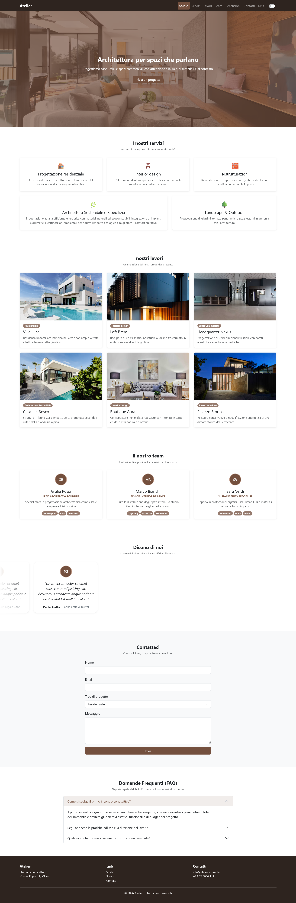

# Atelier

Sito monopagina per uno studio di architettura, realizzato con Bootstrap 5.3.9, CSS custom (senza Sass) e JavaScript vanilla.

```
.
|-- index.html
`-- assets
    |-- css
    |   `-- style.css
    |-- js
    |   `-- script.js
    `-- img
        `-- house-logo.svg
```

Per usarlo basta aprire `index.html` nel browser.

## Anteprima



🔗 **Demo live:** 

## 🧱 Versione base

- **Struttura:** pagina unica con navbar, hero, servizi, contatti e footer.
- **Navbar:** responsive, diventa un menu a hamburger su mobile.
- **Hero:** banner ad altezza quasi piena con titolo, testo e pulsante.
- **Servizi:** tre card in griglia, una per riga su mobile e affiancate da tablet in su, con effetto al passaggio del mouse.
- **Contatti:** form con nome, email, tipo di progetto e messaggio. Senza backend: l'invio svuota il form.
- **Footer:** a tutta larghezza, su colonne da tablet in su.
- **Stile:** palette e spaziature coerenti con la preview, gestite con variabili CSS.

| Elemento | Valore |
|---|---|
| Pulsanti, sfondo principale, hero | `hsl(20, 30%, 35%)` |
| Pulsanti in hover | `hsl(20, 30%, 27%)` |
| Navbar e footer | `hsl(20, 20%, 15%)` |
| Link del footer in hover | `hsl(40, 30%, 90%)` |
| Ombra card / in hover | `0 2px 6px rgba(0,0,0,.08)` / `0 10px 24px rgba(0,0,0,.12)` |

## ✨ Versione extra

- **Servizi ampliati:** da tre a cinque card, con la seconda riga a larghezze diverse.
- **Modale di contatto:** il pulsante dell'hero apre una modale con il form, costruito con floating labels e input group. All'invio si chiude e si svuota.
- **Hero con carosello:** immagini in dissolvenza dietro al testo, con il colore dell'hero come overlay.
- **Team:** schede dei membri con ruolo, descrizione e competenze.
- **Recensioni:** carosello a scorrimento continuo, che si ferma al passaggio del mouse.
- **Tema chiaro/scuro:** switch nella navbar, con cambio fluido.
- **Scrollspy:** la navbar evidenzia la sezione che si sta guardando.
- **FAQ:** domande a scomparsa.
- **Lavori dinamici:** le card sono generate da JavaScript a partire da un elenco di progetti.
- **Animazioni:** entrata degli elementi dell'hero ed effetti hover su card, icone e avatar.


## 🎨 CSS: variabili al posto di Sass

Non uso Sass: ogni personalizzazione sta in `style.css`, caricato dopo Bootstrap, e passa dalle variabili CSS.

- **Variabili del progetto:** colori, ombre, transizioni ed effetti sono definiti una volta sola e riusati ovunque. Per cambiare l'aspetto basta modificare un valore.
- **Variabili di Bootstrap:** quelle globali e quelle dei singoli componenti (pulsanti, accordion, card) sono riassegnate ai valori del progetto, senza riscrivere le regole del framework.
- **Tema scuro e movimento ridotto:** cambiano solo i valori delle variabili, non i selettori, e il cambio avviene a pagina aperta.


### Variabili del progetto

Le variabili sono dichiarate in `:root`.

| Gruppo | Variabili | Dove servono |
|---|---|---|
| Palette | `--color-main`, `--color-main-hover` | pulsanti, hero, voce attiva della navbar, avatar, bordo di focus |
| | `--color-main-soft` | bordo dell'avatar |
| | `--color-dark` | sfondo di navbar e footer |
| | `--color-footer-link-hover` | link del footer in hover |
| | `--color-accent` | ruolo nel team, titolo dell'accordion aperto |
| Superfici | `--bg-soft` | sfondo della sezione Contatti |
| | `--shadow-card`, `--shadow-card-hover` | ombra delle card, normale e in hover |
| | `--card-border-color` | bordo delle card |
| | `--accordion-active-bg` | sfondo dell'elemento aperto dell'accordion |
| Effetti | `--lift` | di quanto sale una card in hover |
| | `--transition`, `--transition-fast` | durata delle transizioni |
| | `--theme-transition` | cambio fluido dei colori tra tema chiaro e scuro |
| | `--focus-ring` | alone di focus di form e accordion |
| | `--hero-img-opacity` | opacità delle immagini nell'hero |

